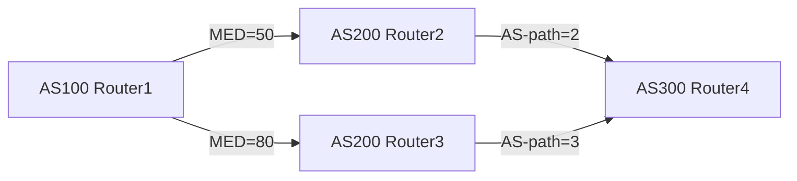

# BGP 路由行为定义、分类与实例清单

## 第一章 路由行为定义

### 1.1 路由行为的本质定义

BGP（Border Gateway Protocol）路由行为，是指边界网关协议在网络边界设备之间传递、处理与决策网络可达性信息的行为集合。BGP 路由行为并非单一机制，而是由选路、通告、聚合、属性处理、环路避免等行为维度构成的复合行为体系。在 BGP 路由行为体系中，路由行为定义的核心在于：BGP 路由器通过 TCP 会话（端口 179）与对等体建立连接，以 UPDATE 报文承载路由信息，并依据一组可比较的路径属性（Path Attributes）对多条候选路径进行择优，最终形成单一活跃路径（Active Route）进入 RIB（Routing Information Base）。该活跃路径随后被注入转发决策链，驱动数据平面完成实际报文转发。

从行为生命周期视角看，BGP 路由行为可分解为四个阶段：**路由生成**（从邻居接收 UPDATE 报文）、**路由决策**（对多条候选路径执行 Best Path Selection）、**路由传播**（向其他邻居通告最优路径）、**路由维护**（通过 Keepalive 与 NLRI 更新维持会话状态）。这四个阶段构成一个闭环，任何阶段的行为异常都可能引发路由黑洞、路由震荡或转发环路。

BGP 路由行为定义还需纳入时间维度。BGP 是距离矢量协议，其路由行为具有明显的收敛延迟特性。当网络拓扑发生变更时，BGP 路由器不会立即同步所有路由信息，而是通过 Incremental Update 机制逐步传播变更。这种异步传播行为导致 BGP 收敛时间可达数秒至数分钟，尤其在路由抖动（Route Flap）场景下，收敛行为可能被进一步放大。因此，路由行为定义必须包含对收敛过程与环路避免机制的描述，否则无法完整刻画 BGP 的运行时行为。

为便于后续章节展开，此处给出 BGP 路由行为的正式定义：

> **定义 1.1（BGP 路由行为）**：BGP 路由行为是指边界网关协议路由器在接收、处理、选择、聚合与通告 IPv4/IPv6 前缀可达性信息过程中，所执行的一系列确定性操作集合。该集合由路径属性比较规则、通告策略、聚合策略、MED/权重/本地优先级处理、AS-path 处理、community 标签处理、收敛时序与环路避免机制共同构成。

该定义强调“确定性操作集合”，意味着 BGP 路由行为是可预测、可配置、可观测的。网络工程师可通过调整 BGP 路由策略（Routing Policy）来改变路由行为，进而影响全网流量走向。这种可调控性正是 BGP 路由行为定义的核心价值——它不仅是协议实现，更是网络工程的操作杠杆。

---

### 1.2 路由决策的核心要素

BGP 路由行为中最关键的子行为是**选路（Route Selection）**。选路行为并非随机，而是遵循一套严格的比较序列。BGP 路由器在收到多条指向同一前缀的候选路由时，按以下优先级顺序逐条比较路径属性：

| 比较顺序 | 路径属性 | 行为含义 |
|---------|---------|---------|
| 1 | 权重（Weight） | 本地路由器对路由源的偏好程度，权重越高越优先 |
| 2 | 本地优先级（Local Preference） | 控制出站流量方向，仅在本 AS 内有效 |
| 3 | 最短 AS-path | 减少中间 AS 跳数，降低转发延迟 |
| 4 | MED（Multi-Exit Discriminator） | 控制入站流量方向，由对端 AS 通告 |
| 5 | 路由来源类型 | IGP 直连 > EGP 外部 > 静态 > 未知 |
| 6 | 路由器 ID 比较 | 用于打破平局，选择 ID 较小者 |
| 7 | 对等体地址比较 | 用于最终打破平局，选择地址较小者 |

上述比较序列构成 BGP 选路行为的“决策链”。值得注意的是，权重与本地优先级是 BGP 路由器本地配置属性，不随路由通告传播；而 AS-path、MED、community 等属性则随 UPDATE 报文跨 AS 传播。这种属性传播差异决定了 BGP 选路行为在不同网络位置呈现不同结果——同一前缀在不同 AS 内可能选择不同路径，这正是 BGP 路由行为“策略性”的体现。

为直观展示选路行为，可构造如下示例：

在此拓扑中，AS100 路由器收到两条指向 AS300 前缀的候选路径。第一条经 Router2，MED=50，AS-path=2；第二条经 Router3，MED=80，AS-path=3。按 BGP 选路规则，AS100 路由器优先比较 MED，MED=50 的路径胜出，尽管其 AS-path 更长。此例说明 MED 在选路行为中的优先级高于 AS-path，且 MED 由对端 AS 通告，体现“入站流量控制”意图。

---

### 1.3 路由通告与传播机制

BGP 路由行为中的**通告（Advertisement）**阶段，决定路由信息如何从源 AS 扩散至全网。BGP 通告行为遵循“路径传播”原则：每条路由仅向对等体通告一次，且通告内容为最优路径（Best Path）。该原则防止路由重复传播，避免无限循环。

通告行为还受**聚合（Aggregation）**影响。BGP 路由器可将多条前缀聚合为一条前缀通告，以减少路由表规模。聚合行为需谨慎处理，因为聚合会丢失路径属性细节，可能导致次优选路。例如，聚合前缀 10.0.0.0/16 覆盖了 10.0.0.0/24 与 10.0.1.0/24，但聚合后的 AS-path 仅保留部分路径信息，可能引发下游路由器选路偏差。

通告行为与**community 标签**密切相关。BGP 路由器可对通告路由附加 community 属性，用于标记路由来源、路由策略或路由归属。community 标签不改变选路行为，但影响下游 AS 的路径策略。例如，通告路由携带 community "NO_EXPORT"，下游 AS 不得将该路由再通告至其他 AS，从而限制路由传播范围。

通告行为的传播路径可表示为：

此链式传播行为构成 BGP 路由扩散的基本模式。但需注意，BGP 通告并非全量扩散——路由器仅向活跃对等体通告最优路径，且遵循“非对称传播”原则：同一路由在不同方向上的通告行为可能不同。这种非对称性由本地优先级、MED 等属性控制，使 BGP 路由行为呈现方向性差异。

---

### 1.4 路由聚合与属性处理

BGP 路由行为中的**聚合（Aggregation）**是路由表压缩的关键机制。聚合行为将多条前缀合并为一条前缀，减少 RIB 条目数量，降低内存占用与 CPU 开销。聚合行为需满足以下条件：

- 前缀必须具有相同的高位比特（Common Prefix）
- 聚合前缀长度小于各子前缀长度
- 聚合前缀的 AS-path 需合并，可能产生 AS-set

聚合行为对路径属性的处理具有特殊性。聚合后的路由可能丢失 MED、community 等属性，导致下游路由器无法获取精确的路径质量信息。为缓解此问题，BGP 支持**有损聚合**与**无损聚合**两类行为。无损聚合通过保留关键属性（如 AS-path 中的 AS-set）来维持路由质量；有损聚合则完全丢弃属性，仅保留可达性信息。

聚合行为与**AS-path 处理**密切相关。当多条子前缀的 AS-path 不同时，聚合行为需构造 AS-set 表示多条路径的 AS 集合。AS-set 在选路行为中视为单一跳数，但实际路径可能包含多个 AS。这种简化可能导致环路风险，因此 BGP 聚合行为必须配合环路避免机制使用。

属性处理行为还包括 **MED 重写**与 **community 重写**。BGP 路由器在通告路由时，可修改 MED 值以影响下游 AS 的入站流量选择；可修改 community 标签以传递本地策略意图。这些重写行为属于“路由策略”范畴，是网络工程师调整 BGP 路由行为的常用手段。

---

### 1.5 路由行为的动态特性

BGP 路由行为具有显著的时间动态性，主要体现在**收敛（Convergence）**与**环路避免（Loop Prevention）**两个维度。

收敛行为描述 BGP 路由信息从变更发生到全网一致的时间过程。BGP 收敛时间受以下因素影响：

- 路由抖动频率（Route Flap Frequency）
- 对等体数量（Peering Count）
- 网络直径（Network Diameter）
- 路由策略复杂度（Policy Complexity）

BGP 收敛行为采用 **PNS（Path Not Selected）** 机制抑制不稳定路由。当路由抖动超过阈值，BGP 路由器进入路由抑制状态，暂停通告该路由，直至抖动平息。该行为有效减少路由震荡对全网的影响，但可能延长收敛时间。

环路避免行为依赖 **AS-path 检测** 与 **聚合环路抑制**。BGP 路由器在接收 UPDATE 报文时，检查 AS-path 是否包含自身 AS 号。若包含，则拒绝该路由，防止环路形成。聚合环路抑制则通过 AS-set 检测实现——若聚合前缀的 AS-set 包含自身 AS 号，则拒绝聚合路由。

收敛与环路避免行为共同保障 BGP 路由体系的稳定性。两者相互配合：收敛行为减少路由变更频率，环路避免行为阻止错误路径传播。这种协同机制使 BGP 路由行为在复杂网络环境中保持可靠运行。

---

**本章小结**：BGP 路由行为定义涵盖选路、通告、聚合、属性处理、收敛与环路避免六大维度。选路行为通过属性比较链确定最优路径；通告行为通过路径传播链扩散路由信息；聚合行为通过前缀合并压缩路由表；属性处理行为通过 MED/community 重写调整路由策略；收敛行为通过抑制机制稳定路由状态；环路避免行为通过 AS-path 检测阻止错误路径。这六大维度相互交织，构成 BGP 路由行为的完整体系。后续章节将逐一展开各维度的分类与实例清单。
