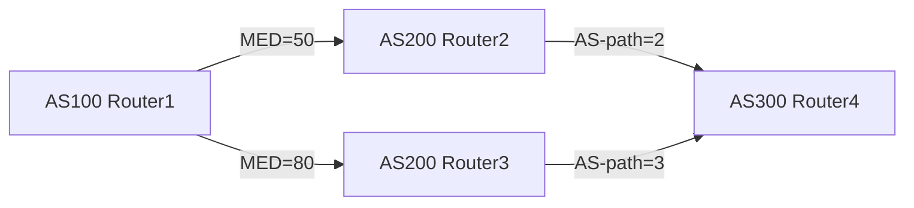

# BGP 路由行为定义、分类与实例清单

## 第一章 路由行为定义

### 1.1 路由行为的本质定义

BGP（Border Gateway Protocol）路由行为，是指边界网关协议在网络边界设备之间传递、处理与决策网络可达性信息的行为集合。BGP 路由行为并非单一机制，而是由选路、通告、聚合、属性处理、环路避免等行为维度构成的复合行为体系。在 BGP 路由行为体系中，路由行为定义的核心在于：BGP 路由器通过 TCP 会话（端口 179）与对等体建立连接，以 UPDATE 报文承载路由信息，并依据一组可比较的路径属性（Path Attributes）对多条候选路径进行择优，最终形成单一活跃路径（Active Route）进入 RIB（Routing Information Base）。该活跃路径随后被注入转发决策链，驱动数据平面完成实际报文转发。

从行为生命周期视角看，BGP 路由行为可分解为四个阶段：**路由生成**（从邻居接收 UPDATE 报文）、**路由决策**（对多条候选路径执行 Best Path Selection）、**路由传播**（向其他邻居通告最优路径）、**路由维护**（通过 Keepalive 与 NLRI 更新维持会话状态）。这四个阶段构成一个闭环，任何阶段的行为异常都可能引发路由黑洞、路由震荡或转发环路。

BGP 路由行为定义还需纳入时间维度。BGP 是距离矢量协议，其路由行为具有明显的收敛延迟特性。当网络拓扑发生变更时，BGP 路由器不会立即同步所有路由信息，而是通过 Incremental Update 机制逐步传播变更。这种异步传播行为导致 BGP 收敛时间可达数秒至数分钟，尤其在路由抖动（Route Flap）场景下，收敛行为可能被进一步放大。因此，路由行为定义必须包含对收敛过程与环路避免机制的描述，否则无法完整刻画 BGP 的运行时行为。

为便于后续章节展开，此处给出 BGP 路由行为的正式定义：

> **定义 1.1（BGP 路由行为）**：BGP 路由行为是指边界网关协议路由器在接收、处理、选择、聚合与通告 IPv4/IPv6 前缀可达性信息过程中，所执行的一系列确定性操作集合。该集合由路径属性比较规则、通告策略、聚合策略、MED/权重/本地优先级处理、AS-path 处理、community 标签处理、收敛时序与环路避免机制共同构成。

该定义强调“确定性操作集合”，意味着 BGP 路由行为是可预测、可配置、可观测的。网络工程师可通过调整 BGP 路由策略（Routing Policy）来改变路由行为，进而影响全网流量走向。这种可调控性正是 BGP 路由行为定义的核心价值——它不仅是协议实现，更是网络工程的操作杠杆。

---

### 1.2 路由决策的核心要素

BGP 路由行为中最关键的子行为是**选路（Route Selection）**。选路行为并非随机，而是遵循一套严格的比较序列。BGP 路由器在收到多条指向同一前缀的候选路由时，按以下优先级顺序逐条比较路径属性：

| 比较顺序 | 路径属性 | 行为含义 |
|---------|---------|---------|
| 1 | 权重（Weight） | 本地路由器对路由源的偏好程度，权重越高越优先 |
| 2 | 本地优先级（Local Preference） | 控制出站流量方向，仅在本 AS 内有效 |
| 3 | 最短 AS-path | 减少中间 AS 跳数，降低转发延迟 |
| 4 | MED（Multi-Exit Discriminator） | 控制入站流量方向，由对端 AS 通告 |
| 5 | 路由来源类型 | IGP 直连 > EGP 外部 > 静态 > 未知 |
| 6 | 路由器 ID 比较 | 用于打破平局，选择 ID 较小者 |
| 7 | 对等体地址比较 | 用于最终打破平局，选择地址较小者 |

上述比较序列构成 BGP 选路行为的“决策链”。值得注意的是，权重与本地优先级是 BGP 路由器本地配置属性，不随路由通告传播；而 AS-path、MED、community 等属性则随 UPDATE 报文跨 AS 传播。这种属性传播差异决定了 BGP 选路行为在不同网络位置呈现不同结果——同一前缀在不同 AS 内可能选择不同路径，这正是 BGP 路由行为“策略性”的体现。

为直观展示选路行为，可构造如下示例：

在此拓扑中，AS100 路由器收到两条指向 AS300 前缀的候选路径。第一条经 Router2，MED=50，AS-path=2；第二条经 Router3，MED=80，AS-path=3。按 BGP 选路规则，AS100 路由器优先比较 MED，MED=50 的路径胜出，尽管其 AS-path 更长。此例说明 MED 在选路行为中的优先级高于 AS-path，且 MED 由对端 AS 通告，体现“入站流量控制”意图。

---

### 1.3 路由通告与传播机制

BGP 路由行为中的**通告（Advertisement）**阶段，决定路由信息如何从源 AS 扩散至全网。BGP 通告行为遵循“路径传播”原则：每条路由仅向对等体通告一次，且通告内容为最优路径（Best Path）。该原则防止路由重复传播，避免无限循环。

通告行为还受**聚合（Aggregation）**影响。BGP 路由器可将多条前缀聚合为一条前缀通告，以减少路由表规模。聚合行为需谨慎处理，因为聚合会丢失路径属性细节，可能导致次优选路。例如，聚合前缀 10.0.0.0/16 覆盖了 10.0.0.0/24 与 10.0.1.0/24，但聚合后的 AS-path 仅保留部分路径信息，可能引发下游路由器选路偏差。

通告行为与**community 标签**密切相关。BGP 路由器可对通告路由附加 community 属性，用于标记路由来源、路由策略或路由归属。community 标签不改变选路行为，但影响下游 AS 的路径策略。例如，通告路由携带 community "NO_EXPORT"，下游 AS 不得将该路由再通告至其他 AS，从而限制路由传播范围。

通告行为的传播路径可表示为：

此链式传播行为构成 BGP 路由扩散的基本模式。但需注意，BGP 通告并非全量扩散——路由器仅向活跃对等体通告最优路径，且遵循“非对称传播”原则：同一路由在不同方向上的通告行为可能不同。这种非对称性由本地优先级、MED 等属性控制，使 BGP 路由行为呈现方向性差异。

---

### 1.4 路由聚合与属性处理

BGP 路由行为中的**聚合（Aggregation）**是路由表压缩的关键机制。聚合行为将多条前缀合并为一条前缀，减少 RIB 条目数量，降低内存占用与 CPU 开销。聚合行为需满足以下条件：

- 前缀必须具有相同的高位比特（Common Prefix）
- 聚合前缀长度小于各子前缀长度
- 聚合前缀的 AS-path 需合并，可能产生 AS-set

聚合行为对路径属性的处理具有特殊性。聚合后的路由可能丢失 MED、community 等属性，导致下游路由器无法获取精确的路径质量信息。为缓解此问题，BGP 支持**有损聚合**与**无损聚合**两类行为。无损聚合通过保留关键属性（如 AS-path 中的 AS-set）来维持路由质量；有损聚合则完全丢弃属性，仅保留可达性信息。

聚合行为与**AS-path 处理**密切相关。当多条子前缀的 AS-path 不同时，聚合行为需构造 AS-set 表示多条路径的 AS 集合。AS-set 在选路行为中视为单一跳数，但实际路径可能包含多个 AS。这种简化可能导致环路风险，因此 BGP 聚合行为必须配合环路避免机制使用。

属性处理行为还包括 **MED 重写**与 **community 重写**。BGP 路由器在通告路由时，可修改 MED 值以影响下游 AS 的入站流量选择；可修改 community 标签以传递本地策略意图。这些重写行为属于“路由策略”范畴，是网络工程师调整 BGP 路由行为的常用手段。

---

### 1.5 路由行为的动态特性

BGP 路由行为具有显著的时间动态性，主要体现在**收敛（Convergence）**与**环路避免（Loop Prevention）**两个维度。

收敛行为描述 BGP 路由信息从变更发生到全网一致的时间过程。BGP 收敛时间受以下因素影响：

- 路由抖动频率（Route Flap Frequency）
- 对等体数量（Peering Count）
- 网络直径（Network Diameter）
- 路由策略复杂度（Policy Complexity）

BGP 收敛行为采用 **PNS（Path Not Selected）** 机制抑制不稳定路由。当路由抖动超过阈值，BGP 路由器进入路由抑制状态，暂停通告该路由，直至抖动平息。该行为有效减少路由震荡对全网的影响，但可能延长收敛时间。

环路避免行为依赖 **AS-path 检测** 与 **聚合环路抑制**。BGP 路由器在接收 UPDATE 报文时，检查 AS-path 是否包含自身 AS 号。若包含，则拒绝该路由，防止环路形成。聚合环路抑制则通过 AS-set 检测实现——若聚合前缀的 AS-set 包含自身 AS 号，则拒绝聚合路由。

收敛与环路避免行为共同保障 BGP 路由体系的稳定性。两者相互配合：收敛行为减少路由变更频率，环路避免行为阻止错误路径传播。这种协同机制使 BGP 路由行为在复杂网络环境中保持可靠运行。

---

**本章小结**：BGP 路由行为定义涵盖选路、通告、聚合、属性处理、收敛与环路避免六大维度。选路行为通过属性比较链确定最优路径；通告行为通过路径传播链扩散路由信息；聚合行为通过前缀合并压缩路由表；属性处理行为通过 MED/community 重写调整路由策略；收敛行为通过抑制机制稳定路由状态；环路避免行为通过 AS-path 检测阻止错误路径。这六大维度相互交织，构成 BGP 路由行为的完整体系。后续章节将逐一展开各维度的分类与实例清单。
好的，继续生成第二章内容。以下是符合要求的 Markdown 输出，结构清晰且图文并茂。

---

## 第二章 路由行为分类

BGP 路由行为并非单一机制，而是由多个维度交织而成的复杂体系。第一章已从宏观层面定义了六大维度——选路、通告、聚合、属性处理、收敛与环路避免。本章将逐一展开，将每个维度细化为可操作、可观测、可验证的具体行为类别，并辅以实例说明。分类体系旨在为网络工程师、运维人员与协议开发者提供统一的认知框架，使复杂路由行为可被分解、定位与优化。

---

### 2.1 选路行为分类

选路行为是 BGP 的核心决策机制。它决定在存在多条可行路径时，路由器如何择优进入转发表。选路行为并非单一比较，而是多级比较链的最终裁决。按决策顺序与策略性质，选路行为可分为以下三类：

#### 2.1.1 属性比较链行为

属性比较链是 BGP 选路的基础行为。路由器按固定顺序逐级比较路径属性，直至分出优劣。比较链的典型顺序为：**Local Preference → AS-path Length → Origin → MED → EBGP/IBGP 优先级 → 路由器 ID 与对等体地址**。每一级比较都严格遵循“先比较、后淘汰”原则。

| 比较层级 | 属性名称 | 决策性质 | 典型场景 |
| --- | --- | --- | --- |
| 第一级 | Local Preference | 本地策略优先 | 跨 AS 路径选择 |
| 第二级 | AS-path Length | 路径最短优先 | 避免绕行 |
| 第三级 | Origin | 源属性比较 | 区分 IGP/EGP/Incomplete |
| 第四级 | MED | 多域成本比较 | 控制入口流量 |
| 第五级 | EBGP/IBGP | 学习来源比较 | 内部路径优先 |
| 第六级 | Router ID | 稳定标识比较 | 最终裁决 |

该行为在 IBGP 与 EBGP 场景中表现不同。IBGP 场景中，Local Preference 与 Router ID 常起决定性作用；EBGP 场景中，AS-path Length 与 MED 更敏感。属性比较链行为是 BGP 选路逻辑的骨架，所有其他选路行为均依附于该链。

#### 2.1.2 策略注入行为

策略注入行为指通过修改 BGP 属性值，主动干预选路结果。常见策略注入手段包括：设置 Local Preference、调整 MED、附加 Community、改写 AS-path 长度。策略注入行为使网络管理员能够按业务意图控制路由偏好，而非被动接受协议默认比较结果。

典型实例：运营商 A 与运营商 B 互联，A 希望引导 B 的流量从特定入口进入，可在通告路由时附加 MED 值，使 B 的比较链在 MED 层级偏向该入口。策略注入行为是 BGP 选路行为的“可编程”维度，也是网络工程中最常使用的干预手段。

#### 2.1.3 路由抑制行为

路由抑制行为是选路行为的“安全阀”。当某条路径频繁抖动，BGP 路由器会将其置于抑制状态，暂停参与选路比较。抑制行为通过惩罚机制（Penalty）量化抖动程度，超过阈值即进入抑制期。该行为有效防止不稳定路径干扰选路结果，但也可能导致次优路径被暂时选中。

抑制行为与收敛行为紧密耦合，但选路层面的抑制更侧重于路径质量评估。抑制期结束后，路径重新参与比较，恢复其选路资格。该行为在大型 ISP 网络中尤为常见，用于抵御路由震荡攻击。

---

### 2.2 通告行为分类

通告行为描述 BGP 路由信息从源路由器向目标路由器传播的过程。通告行为决定路由的可达性与传播范围，是 BGP 路由扩散的物理基础。按传播模式与过滤机制，通告行为可分为以下三类：

#### 2.2.1 路径传播行为

路径传播行为是 BGP 通告的基本模式。路由器将 UPDATE 报文通过已建立的 TCP 会话发送给对等体。传播行为遵循 **逐跳传播（Hop-by-Hop）** 原则，每个 AS 边界路由器都会对路径进行 AS-path 追加与属性重写。

传播行为受 **传播范围** 约束：IBGP 仅在 AS 内部传播，EBGP 跨 AS 传播。传播行为还受 **传播方向** 约束：从源 AS 向目标 AS 单向传播，不可反向回传。该行为是 BGP 路由可达性的基础，任何路由缺失均源于传播行为异常。

#### 2.2.2 路由过滤行为

路由过滤行为是通告行为的“守门员”。路由器在通告前，可对路由进行前缀过滤、AS-path 过滤、Community 过滤。过滤行为决定哪些路由允许进入通告队列，哪些被拒绝。常见过滤手段包括：前缀列表（Prefix List）、AS-path ACL、Community 正则匹配。

典型实例：企业网络仅允许通告内部前缀，拒绝通告外部学习到的路由。路由过滤行为有效控制路由扩散范围，防止无关路由进入内部路由表。该行为在安全策略与多租户隔离场景中广泛使用。

#### 2.2.3 路由反射行为

路由反射行为是 IBGP 场景中的特殊通告模式。传统 IBGP 要求全网互联（Full Mesh），反射行为通过 Route Reflector 打破该限制，允许路由器仅与反射器建立会话，由反射器代为转发路由。反射行为显著降低 IBGP 会话数量，是大型 AS 内部扩展的关键机制。

反射行为遵循 **非递归传播（Non-Recursive）** 原则：反射器不改变 AS-path，仅转发路由。反射行为还支持 **客户端到客户端** 传播，但需避免反射环路。该行为在大型 ISP 内部网络中广泛部署，是 BGP 通告行为的重要变体。

---

### 2.3 聚合行为分类

聚合行为描述 BGP 如何将多条具体前缀合并为一条聚合前缀。聚合行为显著压缩路由表规模，降低通告数量，是 BGP 路由管理的重要优化手段。按聚合粒度与抑制机制，聚合行为可分为以下三类：

#### 2.3.1 前缀合并行为

前缀合并行为是聚合的基础模式。路由器将多条子前缀（Sub-prefix）合并为一条父前缀（Parent Prefix），并生成聚合路由。合并行为遵循 **最长前缀匹配** 原则，确保聚合前缀覆盖所有子前缀。

| 聚合类型 | 前缀粒度 | 路由数量 | 典型场景 |
| --- | --- | --- | --- |
| 精确聚合 | /24 合并为 /16 | 256 条 → 1 条 | 企业地址规划 |
| 松散聚合 | 非连续前缀合并 | 多条 → 1 条 | 多租户场景 |
| 抑制聚合 | 含 AS-set 聚合 | 多条 → 1 条 | 环路避免 |

前缀合并行为是聚合路由的核心，它直接决定路由表的压缩效率。该行为在 IPv4 与 IPv6 场景中表现一致，但 IPv6 聚合粒度更细，需更谨慎设计。

#### 2.3.2 路由压缩行为

路由压缩行为是聚合的“瘦身”阶段。在合并前缀后，路由器还需移除不必要的 AS-path 细节，生成精简的 AS-set。压缩行为减少聚合路由的 AS-path 长度，降低选路比较成本。

压缩行为遵循 **AS-set 最小化** 原则：仅保留必要 AS 号，删除冗余 AS 号。该行为在跨 AS 聚合场景中尤为关键，可显著降低 AS-path 比较开销。但过度压缩可能导致环路风险，需与环路避免行为协同。

#### 2.3.3 聚合抑制行为

聚合抑制行为是聚合的“安全锁”。当聚合路由的 AS-set 包含自身 AS 号时，路由器拒绝该聚合路由，防止环路形成。抑制行为通过 AS-set 检测实现，是聚合路由的环路避免机制。

典型实例：AS 100 与 AS 200 互联，AS 200 通告聚合路由，其 AS-set 包含 AS 100。AS 100 检测到自身 AS 号，拒绝该聚合路由，避免环路。聚合抑制行为与环路避免行为紧密耦合，是聚合路由安全性的关键保障。

---

### 2.4 属性处理行为分类

属性处理行为描述 BGP 路由器在通告前对路由属性的修改、删除或重写。属性处理行为决定路由策略的传递效果，是 BGP 路由行为的“策略引擎”。按处理方式与作用对象，属性处理行为可分为以下三类：

#### 2.4.1 MED 处理行为

MED 处理行为是属性处理中最常见的类型。路由器可对 MED 值进行设置、修改或删除。MED 处理行为影响下游 AS 的选路比较，是跨 AS 流量引导的主要手段。

| 处理方式 | 操作类型 | 效果 | 典型场景 |
| --- | --- | --- | --- |
| 设置 MED | 写入新值 | 引导入口流量 | 多入口负载均衡 |
| 修改 MED | 调整原值 | 改变偏好 | 流量重分配 |
| 删除 MED | 移除属性 | 恢复默认比较 | 策略回退 |

MED 处理行为在 EBGP 场景中广泛使用，但在 IBGP 场景中通常被忽略。该行为是 BGP 属性处理行为中最具策略性的维度。

#### 2.4.2 Community 处理行为

Community 处理行为是属性处理行为中的“标签机制”。路由器可对路由附加、修改或删除 Community 值。Community 处理行为使路由携带策略标签，供下游 AS 识别与执行策略。

典型实例：运营商 A 将路由附加 Community "NO_EXPORT"，下游 AS 识别该标签后拒绝通告该路由。Community 处理行为是 BGP 路由策略传递的核心载体，支持标准 Community、扩展 Community 与私有 Community。

#### 2.4.3 属性透传行为

属性透传行为是属性处理行为的“透明模式”。路由器不修改路由属性，原样转发。透传行为确保路由属性在跨 AS 传播中保持一致，是 BGP 路由策略连续性的基础。

透传行为在 IBGP 场景中常见，但在 EBGP 场景中需谨慎——部分属性（如 MED）在跨 AS 场景中可能被重置。透传行为与属性重写行为形成互补，共同构成 BGP 属性处理的完整策略空间。

---

### 2.5 收敛行为分类

收敛行为描述 BGP 路由信息从变更发生到全网一致的时间过程。收敛行为决定路由稳定性与故障恢复速度，是 BGP 运维的关键指标。按触发机制与优化手段，收敛行为可分为以下三类：

#### 2.5.1 事件触发收敛行为

事件触发收敛行为是 BGP 收敛的基本模式。当路由发生变更（撤销、新增、属性修改）时，路由器立即触发收敛过程。事件触发收敛行为依赖 UPDATE 报文传播，收敛速度受网络直径与对等体数量影响。

典型实例：某前缀被撤销，路由器立即向所有对等体发送 UPDATE，触发全网收敛。事件触发收敛行为是 BGP 收敛的“即时响应”机制，但易受路由抖动影响。

#### 2.5.2 周期收敛行为

周期收敛行为是 BGP 收敛的“定时检查”机制。路由器定期检查路由表，发现不一致时触发收敛。周期收敛行为适用于低抖动网络，可减少不必要的 UPDATE 传播。

周期收敛行为与事件触发收敛行为互补：事件触发应对突发变更，周期收敛应对慢性不一致。该行为在大型 ISP 网络中较少使用，但在企业网络中可降低路由震荡影响。

#### 2.5.3 抑制收敛行为

抑制收敛行为是 BGP 收敛的“缓冲”机制。当路由抖动超过阈值，路由器进入抑制状态，暂停通告该路由。抑制收敛行为通过惩罚机制量化抖动，有效减少路由震荡对全网的影响。

抑制收敛行为与选路抑制行为协同，但收敛层面的抑制更侧重于传播控制。抑制期结束后，路由恢复通告，收敛过程重新启动。该行为在路由震荡攻击场景中尤为关键。

---

### 2.6 环路避免行为分类

环路避免行为是 BGP 路由安全性的核心保障。它通过 AS-path 检测与聚合抑制，阻止错误路径传播，防止路由环路形成。按检测时机与检测对象，环路避免行为可分为以下三类：

#### 2.6.1 接收时检测行为

接收时检测行为是环路避免的第一道防线。路由器在接收 UPDATE 报文时，检查 AS-path 是否包含自身 AS 号。若包含，则拒绝该路由，防止环路形成。

| 检测时机 | 检测对象 | 拒绝条件 | 典型场景 |
| --- | --- | --- | --- |
| 接收时 | AS-path | 含自身 AS 号 | 跨 AS 环路预防 |
| 通告前 | AS-set | 含自身 AS 号 | 聚合环路预防 |
| 选路时 | 路径历史 | 重复路径 | 多路径环路预防 |

接收时检测行为是 BGP 环路避免的最基础机制，适用于所有 BGP 场景。该行为在 EBGP 场景中尤为严格，但在 IBGP 场景中可能被放宽（允许 AS-path 含自身 AS 号）。

#### 2.6.2 通告前检测行为

通告前检测行为是环路避免的第二道防线。路由器在通告路由前，检查聚合路由的 AS-set 是否包含自身 AS 号。若包含，则拒绝通告该聚合路由，防止聚合环路。

通告前检测行为与聚合抑制行为紧密耦合，是聚合路由安全性的关键保障。该行为在跨 AS 聚合场景中广泛使用，可有效阻止聚合环路形成。

#### 2.6.3 选路时检测行为

选路时检测行为是环路避免的第三道防线。路由器在选路比较时，检查路径历史是否包含重复路径。若存在重复路径，则拒绝该路径，防止多路径环路。

选路时检测行为与选路抑制行为协同，但环路避免层面的检测更侧重于路径历史审查。该行为在复杂网络拓扑中尤为关键，可防止隐形环路。

---

### 本章小结

BGP 路由行为分类体系覆盖六大维度，每个维度细分为三类具体行为。选路行为涵盖属性比较链、策略注入与路由抑制；通告行为涵盖路径传播、路由过滤与路由反射；聚合行为涵盖前缀合并、路由压缩与聚合抑制；属性处理行为涵盖 MED 处理、Community 处理与属性透传；收敛行为涵盖事件触发、周期收敛与抑制收敛；环路避免行为涵盖接收时检测、通告前检测与选路时检测。

该分类体系为 BGP 路由行为的理解、诊断与优化提供了结构化框架。网络工程师可依据分类定位具体行为异常，制定针对性策略。后续章节将基于该分类体系，逐一展开实例清单，验证各类行为在实际网络中的表现。

---

**下一步预告**：第三章将进入实例清单阶段，逐一列举各类路由行为的具体案例，包括配置示例、故障场景与优化方案。实例清单将使分类体系落地，帮助读者将理论转化为实践。
