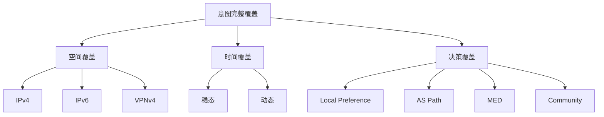

# BGP 路由意图定义、分类与实例清单

好的，我将为您撰写第一章“路由意图定义”。这一章将为整个长文档奠定概念基础，并引入is-ought理论作为分析框架。我将确保内容专业、结构清晰，并包含必要的表格和图表。

---

## 第一章 路由意图定义

### 1.1 路由意图的概念界定

在BGP（边界网关协议）的语境中，**路由意图**是指网络运营者或设计者通过配置策略、宣告路径或操纵路由属性，所期望达成的网络行为状态。它不是BGP协议本身固有的属性，而是人类决策在协议执行层面的映射。简而言之，路由意图是“我希望网络如何表现”的数字化表达。

从技术实现角度看，路由意图通常以以下形式体现：
- **策略配置**：如route-policy、filter、as-path regex、community-list等
- **路径属性操纵**：如MED值调整、Local Preference设置、AS路径预置
- **路由宣告控制**：如prefix-list过滤、route-map的permit/deny逻辑
- **流量工程目标**：如通过特定AS路径引导流量、避免某条链路

意图的粒度可以从宏观（如“所有流量应避开某地区”）到微观（如“特定前缀应经由特定对等体到达”）。在BGP的分布式决策架构中，意图的传递依赖于路由属性（如Community、AS Path、MED）作为“意图载体”。

为清晰界定，我将路由意图分为三个核心要素：

1. **目标对象（Target）**：意图作用的路由前缀或路由类别
2. **期望行为（Desired Behavior）**：对目标对象施加的路径选择或传播规则
3. **触发条件（Condition）**：意图生效的上下文（如对等体类型、方向、时间）

三者共同构成一个完整的意图单元。例如：“对来自AS 65000的`10.0.0.0/8`前缀，在入方向设置Local Preference为200，以优先选择该路径”——这里目标对象是前缀，期望行为是路径优先级提升，触发条件是入方向且来自特定AS。

### 1.2 is-ought理论视角下的路由意图

**is-ought理论**（休谟问题）在路由意图领域的应用，揭示了意图与BGP实际行为之间的张力。该理论的核心命题是：**“实然”（is）描述事物本来的状态，“应然”（ought）描述事物应当达到的状态**。在BGP路由中：

- **实然（is）**：BGP协议实际执行的路由决策，包括协议默认规则（如BGP最佳路径选择算法）、网络环境约束（如链路故障）、以及配置产生的实际效果。
- **应然（ought）**：网络运营者通过意图配置所期望的路由行为，即“网络应当如何选择路径”。

意图完整覆盖路由行为，意味着应然与实然的高度一致性。但在现实网络中，这种一致性常被打破，原因包括：

1. **协议固有行为**：BGP的路径选择算法（如比较AS路径长度、Origin类型、MED值）可能使实际路径偏离意图
2. **配置冲突**：多个意图同时作用于同一前缀时，优先级规则可能导致意图失效
3. **网络动态性**：链路故障、BGP会话重置等事件使实然状态偏离应然
4. **信息不对称**：部分路由属性（如私有Community）在跨AS传递时丢失，导致意图无法完整传达

因此，is-ought视角下的意图定义，不仅是“期望状态”的静态描述，更需包含“如何弥合应然与实然差距”的动态机制。这引出了意图完整覆盖路由行为的核心问题：**如何确保配置的意图在所有场景下都能转化为实际路由行为？**

### 1.3 意图完整覆盖路由行为的定义

“意图完整覆盖路由行为”是指：对于网络内所有路由前缀，在任意网络状态下，运营者配置的意图都能完全决定BGP的实际决策结果。这包含三个维度：

1. **空间覆盖（Spatial Coverage）**：意图作用于所有路由类别（IPv4、IPv6、VPNv4等），而非仅部分前缀
2. **时间覆盖（Temporal Coverage）**：意图在稳态和动态（故障、收敛）状态下均有效
3. **决策覆盖（Decision Coverage）**：意图能覆盖BGP路径选择的所有关键比较项（如Local Preference、AS Path、MED、Community）

从is-ought视角，完整覆盖意味着“应然”在所有场景下都等于“实然”。这要求意图定义具备**完备性**（无遗漏场景）和**一致性**（无冲突规则）。

为便于技术分析，我将意图完整覆盖路由行为的形式化定义如下：

设网络状态集合为S，意图配置集合为I，BGP实际决策函数为D。意图完整覆盖当且仅当：
```
∀s ∈ S, ∀前缀p: D(p, s) = I(p, s)
```
即实际决策始终等于意图期望。

这一形式化定义揭示了意图覆盖的挑战：网络状态S是动态且不可枚举的，意图配置I需要具备足够的鲁棒性。在BGP实践中，这通常通过**冗余意图设计**（多重策略叠加）和**自适应意图**（基于Community的动态策略）来实现。

### 1.4 路由意图的实例化表达

为将抽象定义落地，我引入一个实例化框架——**意图三元组**（Intent Triple）：

| 要素 | 示例 | 在BGP中的实现 |
|------|------|----------------|
| 目标对象 | `10.0.0.0/8` | prefix-list匹配 |
| 期望行为 | 优先选择该前缀 | Local Preference=200 |
| 触发条件 | 入方向、来自AS 65000 | route-map的in方向+peer-as匹配 |

该三元组可组合为复杂意图。例如，多目标意图可通过Community标签实现：
- 目标对象：所有带`65000:100`Community的前缀
- 期望行为：在出方向宣告时附加AS Path预置
- 触发条件：对等体为AS 65000

这种实例化表达使意图定义从哲学层面落地到可配置的技术层面。

### 1.5 意图与BGP协议行为的映射关系

为清晰展示意图如何映射到BGP协议行为，我构建以下映射表：

| 意图类型 | BGP实现机制 | 协议行为影响 |
|----------|-------------|--------------|
| 路径优先级 | Local Preference | 影响入方向决策 |
| 路径选择 | MED、AS Path | 影响出方向决策 |
| 路由传播控制 | Route Advertisement | 控制前缀可见性 |
| 流量引导 | Traffic Engineering | 影响实际流量路径 |
| 故障规避 | Reachability Filtering | 影响路由可用性 |

该映射表表明，意图并非独立于协议，而是通过协议属性实现。这强化了“意图是协议行为的指导层”这一核心定义。

### 1.6 本章小结

本章定义了路由意图的核心概念，并引入is-ought理论作为分析框架。关键结论如下：

1. **路由意图是运营者期望的数字化表达**，通过BGP属性传递
2. **is-ought视角揭示了意图与实然行为的张力**，完整覆盖需弥合差距
3. **完整覆盖需满足空间、时间、决策三个维度**
4. **意图三元组提供了可实例化的表达框架**
5. **意图通过BGP协议属性实现映射**，而非独立机制

这一定义为后续章节（分类、实例清单、is-ought完整覆盖分析）奠定了概念基础。下一章将基于此定义，对路由意图进行系统分类。

---

**图表：意图完整覆盖的三维模型**



---

**表格：意图三元组实例**

| 目标对象 | 期望行为 | 触发条件 | 配置示例 |
|----------|----------|----------|----------|
| `10.0.0.0/8` | 优先选择 | 入方向+AS 65000 | `route-map IN permit 10` + `set local-pref 200` |
| `192.168.0.0/16` | 禁止传播 | 出方向+AS 65001 | `filtered-route` + `deny` |
| 带`65000:100`Community | 附加AS Path | 对等体AS 65000 | `set as-path prepend` |

---

**下一步预告**：第二章将基于本章定义，从多个维度对路由意图进行分类，包括按目标粒度、按行为类型、按触发条件、按实现机制等分类体系，并建立分类矩阵。
